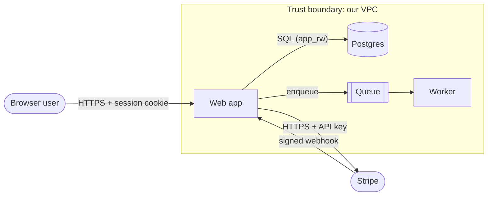

# Secure design guide: method, principles and threat modeling

Sources: OWASP Secure Product Design, Threat Modeling, Attack Surface Analysis and Abuse Case cheat sheets;
NIST SP 800-218 (SSDF). Technology-neutral. Design flaws are not fixed by patching a line: they are missing
or misplaced controls in how the system is put together. The goal is to make security decisions **explicit**
and proportionate (no over- or under-engineering).

---

## 1. The four questions (Threat Modeling Cheat Sheet)

1. **What are we working on?** Model the system: components, data flows, data stores, external entities and
   **trust boundaries** (where data or control crosses from one trust level to another).
2. **What can go wrong?** Apply STRIDE to each component, flow and boundary crossing.
3. **What are we going to do about it?** For each threat choose: **mitigate**, **eliminate** (remove the
   feature/flow), **transfer** (to a provider; it doesn't reduce risk, so record the residual risk and owner),
   or **accept** (with an owner and a reason).
4. **Did we do a good enough job?** Validate the model matches the system, threats are covered, mitigations are
   measurable and turned into requirements and tests.

## 2. Modelling the system

Use the surface map as raw material, then draw a data-flow diagram (Mermaid is fine in Markdown):

For each flow note: protocol, authentication, authorization point, data classification, and validation.

## 3. STRIDE prompts

| Threat | Property | Ask at each component/flow/boundary | Typical controls |
|---|---|---|---|
| **S**poofing | Authentication | Can someone pretend to be a user, service or webhook sender? | strong authn, mTLS/signed requests, MFA |
| **T**ampering | Integrity | Can data in transit/at rest/in queues be modified? Can clients set values they shouldn't? | TLS, signatures, server-side validation, immutable logs |
| **R**epudiation | Accountability | Could a user deny an action and we can't prove it? | audit logs with identity, tamper-evident storage |
| **I**nformation disclosure | Confidentiality | Who can read this data, including logs, caches, backups, errors, other tenants? | authz per object, encryption, minimization, redaction |
| **D**enial of service | Availability | Can one actor exhaust CPU, memory, money (LLM tokens), queues, rate limits of providers? | quotas, limits, timeouts, circuit breakers |
| **E**levation of privilege | Authorization | Can a user/service gain rights it shouldn't (admin endpoints, role fields, confused deputy)? | deny-by-default policy, least privilege, separation |

Complement with **abuse cases** for business workflows (Abuse Case Cheat Sheet): "as an attacker I want to …"
(redeem a coupon twice, enumerate users, scrape all listings, skip payment, cancel someone else's order, run
the LLM for free), each with a control and a test. Add LINDDUN for privacy-heavy products.

## 4. Ranking

Rate likelihood × impact (High/Medium/Low each), factoring in exploit effort and existing controls. Prioritize
High×High at trust boundaries, internet-facing entry points, money movement, and cross-tenant data.

## 5. Principles to check the design against (Secure Product Design Cheat Sheet)

- **Least privilege and separation of duties**: users, services, CI, database accounts, cloud roles, tools
  given to AI agents. Sensitive operations need two people or two factors.
- **Defence in depth**: layered controls (network, application, data); assume one layer fails; detect and respond.
- **Zero trust**: internal callers are authenticated and authorized too; no "it's on the private network".
- **Secure defaults and fail secure**: locked down out of the box; errors and dependency failures deny.
- **Minimize attack surface**: remove what isn't needed; separate admin from public.
- **Security in the open**: developers understand the security implications of their code; reviews and tests.

## 6. The five focus areas

| Area | Questions |
|---|---|
| **Context** | Who uses it, what data, which regulations, what business impact (sets the security level)? |
| **Components** | Which libraries/services, are they maintained and trusted, are paved-road components used? |
| **Connections** | Every data flow and store, segregation of tiers/tenants/environments, intentional non-connections. Adding/removing connections is a design-level change. |
| **Code** | Input validation, parameterized queries, secure error handling, central authn/authz, crypto in transit/at rest, no secrets in code, security tests, abuse-case tests per tier, plausibility checks between tiers. |
| **Configuration** | Minimal permissions, layered controls, secure-by-default, encryption, backups/retention, secure protocols, updates, incident response in the support model. |

## 7. From threats to requirements

Each mitigation becomes a testable requirement ("all `/api/*` routes require a valid session except
`/api/health`", "every query on `orders` filters by `tenant_id`", "refunds above $500 require a second
approver") with an owner and a test. Feed specific checks to the specialised skills (`/sk-api`, `/sk-auth`,
`/sk-oauth2`, `/sk-database`, `/sk-docker`, `/sk-cicd`, `/sk-prompt-injection`, `/sk-rag`, `/sk-rest`).
